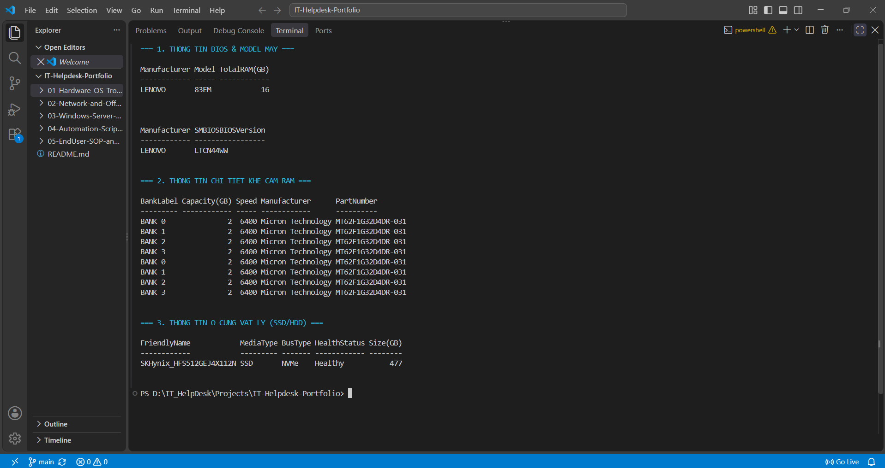
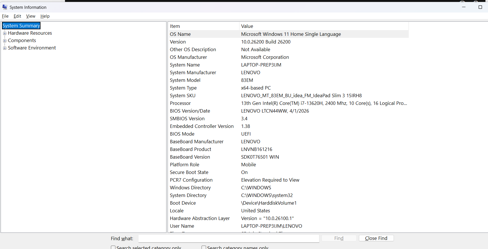
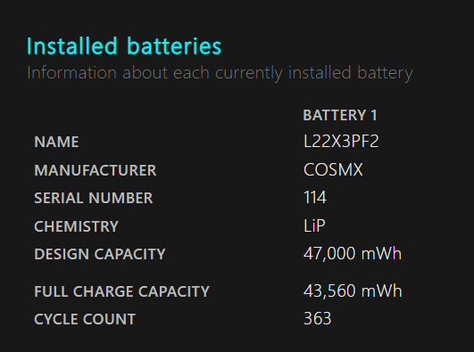

# Lab 01: Kiểm kê Phần cứng bằng PowerShell & Quy trình Onboarding Thiết bị

## 1. Tình huống thực tế (Scenario)
Trong ngày đầu nhận việc, IT Helpdesk cần kiểm tra nhanh thông số phần cứng (Model, chuẩn BIOS UEFI/Legacy, số khe RAM, chuẩn ổ cứng SSD NVMe/SATA, độ chai pin) của các laptop thu hồi để nâng cấp và chuẩn bị bàn giao cho nhân viên mới (Onboarding).

## 2. Công cụ & Lệnh thực thi
- **PowerShell (CIM/WMI Cmdlets):** `Get-CimInstance`, `Get-PhysicalDisk`
- **Windows Built-in Tools:** `msinfo32`, `dxdiag`, `powercfg /batteryreport`

## 3. Kết quả kiểm tra trên thiết bị thực tế
- **Model thiết bị:** `LENOVO 83EM (IdeaPad Slim 3 15IRH8)`
- **Chuẩn khởi động (BIOS Mode):** `UEFI` (Secure Boot: `On`)
- **Cấu hình RAM:** `16 GB - Micron Technology (Bus 6400 MHz)`
- **Ổ cứng vật lý:** `SKHynix_HFS512GEJ4X112N (477 GB)` | Giao thức (`BusType`): `NVMe` | Tình trạng (`HealthStatus`): `Healthy`
- **Độ chai pin (Battery Health):** Dung lượng thực tế `43560 mWh` / Dung lượng thiết kế `47000 mWh` (Đạt `92.7%`)

### Hình ảnh minh chứng thực hành:
#### a) Kiểm tra RAM và chuẩn ổ cứng bằng PowerShell

#### b) Kiểm tra chuẩn UEFI và Secure Boot trong System Information (`msinfo32`)

#### c) Báo cáo sức khỏe Pin (`powercfg /batteryreport`)

---

## 4. Quy trình & Checklist Chuẩn bị Máy tính cho Nhân viên mới (Onboarding Checklist)

| STT | Hạng mục công việc (Task) | Chi tiết kỹ thuật | Trạng thái |
| :--- | :--- | :--- | :---: |
| 1 | Kiểm tra ngoại quan & Dán nhãn tài sản | Dán tem `Asset Tag`, lưu Serial Number vào bảng quản lý tài sản (ITAM). | [x] |
| 2 | Cài đặt OS & Đặt tên máy (Hostname) | Cài Windows 11 Pro (UEFI/GPT), đặt Hostname theo chuẩn `[PhongBan]-[TenNV]`. | [x] |
| 3 | Phân quyền tài khoản người dùng | Tạo tài khoản `IT_Admin` (Local Admin) và cấp tài khoản `Standard User` cho nhân viên. | [x] |
| 4 | Cài đặt phần mềm tiêu chuẩn | Microsoft 365 (Word, Excel, Outlook, Teams), Unikey, 7-Zip, Foxit PDF, Chrome, UltraViewer. | [x] |
| 5 | Cấu hình mạng & Thiết bị ngoại vi | Kết nối Wi-Fi nội bộ, cài đặt Driver máy in văn phòng, ánh xạ ổ đĩa mạng (Map Network Drive). | [x] |
| 6 | Bàn giao & Ký xác nhận | Hướng dẫn nhân viên đăng nhập lần đầu và ký Biên bản bàn giao thiết bị. | [x] |

---

## 5. Xử lý tình huống phần cứng thực tế (Troubleshooting Case)
- **Tình huống:** Nhân viên được cấp màn hình rời chỉ có cổng **VGA** và **DisplayPort**, trong khi Laptop chỉ có cổng **HDMI** và cổng **USB Type-C (chỉ truyền dữ liệu, không hỗ trợ DisplayPort Alt Mode)**.
- **Giải pháp xử lý:** 
  1. Không thể dùng cáp chuyển từ cổng USB Type-C do cổng này trên máy không hỗ trợ xuất hình ảnh.
  2. Phương án tối ưu nhất: Sử dụng **cáp hoặc đầu chuyển đổi có chip chuyển mạch chủ động từ HDMI (Input - cắm vào Laptop) sang VGA (Output - cắm vào màn hình)** (Lưu ý: Cáp HDMI-to-VGA là cáp 1 chiều, phải chọn đúng chiều từ nguồn phát HDMI sang màn hình VGA).
