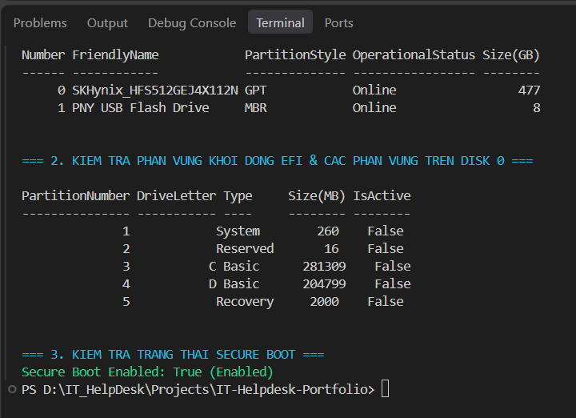
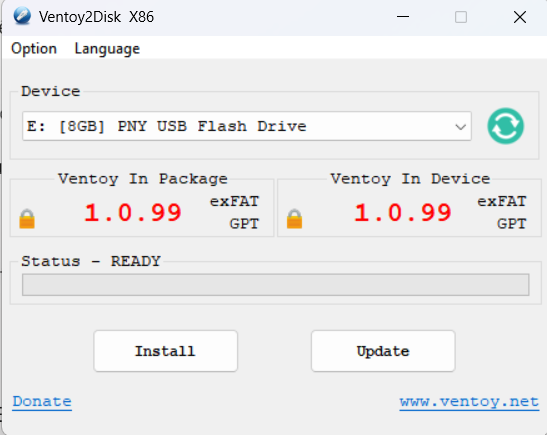

# Lab 02: Chẩn đoán Phần cứng Khởi động (POST), Chuẩn UEFI/GPT & Tạo USB Cứu hộ Multiboot

## 1. Tình huống thực tế (Scenario)
Xử lý sự cố máy tính nhân viên không khởi động vào được Windows (báo lỗi *No Bootable Device* hoặc lỗi bảng phân vùng MBR/GPT khi cài lại hệ điều hành) và chuẩn bị USB Multiboot cứu hộ dữ liệu qua môi trường WinPE.

## 2. Công cụ & Lệnh thực thi
- **PowerShell Storage & Registry:** `Get-Disk`, `Get-Partition`, `HKLM:\...\SecureBoot\State`
- **Windows Utilities:** `diskmgmt.msc`, `mbr2gpt.exe`
- **Rescue Tool:** Ventoy Multiboot USB (cấu hình chuẩn `GPT` + `Secure Boot Support`), WinPE (Hiren's BootCD PE / Anhdv Boot).

## 3. Kết quả kiểm tra cấu trúc Khởi động & Phân vùng trên thiết bị
- **Ổ cứng kiểm tra:** `SKHynix_HFS512GEJ4X112N`
- **Chuẩn bảng phân vùng (Partition Style):** `GPT`
- **Trạng thái Secure Boot:** `False (Off)`
- **Cấu trúc 5 phân vùng trên Disk 0:**
  1. **Partition 1 (System - EFI):** `260 MB` (Chứa Bootloader UEFI)
  2. **Partition 2 (Reserved - MSR):** `16 MB` (Phân vùng hệ thống Microsoft)
  3. **Partition 3 (Basic - Ổ C):** `281,309 MB (~275 GB)` (Chứa Hệ điều hành)
  4. **Partition 4 (Basic - Ổ D):** `204,799 MB (~200 GB)` (Chứa Dữ liệu)
  5. **Partition 5 (Recovery):** `2,000 MB` (Phân vùng khôi phục Windows RE)

### Hình ảnh minh chứng thực hành:
#### a) Kiểm tra chuẩn phân vùng GPT, EFI System Partition và Secure Boot bằng PowerShell

#### b) Công cụ tạo USB Multiboot Ventoy / Cấu trúc phân vùng trên Disk Management

---

## 4. Bảng tổng hợp Phím tắt vào BIOS & Boot Menu của các dòng máy Văn phòng

| Hãng Laptop / PC | Phím tắt vào Boot Menu (Chọn USB) | Phím tắt vào BIOS / UEFI Setup |
| :--- | :---: | :---: |
| **Lenovo (IdeaPad / ThinkPad)** | `F12` (hoặc nút Novo cạnh sườn máy) | `F2` (hoặc `Fn + F2`) / `F1` (ThinkPad) |
| **Dell (OptiPlex / Latitude / Vostro)** | `F12` | `F2` |
| **HP (ProBook / EliteBook / ProDesk)** | `F9` | `F10` (hoặc `Esc`) |
| **Asus / Acer** | `Esc` (Asus) / `F12` (Acer) | `F2` hoặc `Del` |

---

## 5. Kịch bản Xử lý Sự cố Thực tế (Troubleshooting Cases)

### Tình huống 1: Lỗi "Windows cannot be installed to this disk. The selected disk has an MBR partition table"
- **Nguyên nhân:** USB cài đặt đang được boot ở chế độ **UEFI**, nhưng ổ cứng trong máy lại đang định dạng theo chuẩn cũ **MBR**.
- **Cách khắc phục:**
  1. **Nếu ổ cứng trống (máy mới):** Tại màn hình cài đặt Windows, nhấn `Shift + F10` để mở CMD -> gõ `diskpart` -> `list disk` -> `select disk 0` -> `clean` -> `convert gpt` -> `exit` rồi bấm Refresh để cài tiếp.
  2. **Nếu ổ cứng đang có dữ liệu quan trọng ở ổ D:** Tuyệt đối không dùng lệnh `clean`. Boot vào **WinPE** trên USB cứu hộ, mở phần mềm **MiniTool Partition Wizard** -> chuột phải vào ổ cứng chọn **Convert MBR Disk to GPT Disk** -> bấm **Apply** (chuyển đổi trong 5 giây không mất dữ liệu), hoặc dùng lệnh `mbr2gpt /convert /allowfullos`.

### Tình huống 2: Cứu dữ liệu trên Desktop khi Windows bị lỗi không vào được màn hình chính
- **Cách khắc phục bằng USB WinPE:**
  1. Cắm USB Multiboot (Ventoy), bật máy nhấn liên tục phím `F12` (Lenovo/Dell) hoặc `F9` (HP) để vào **Boot Menu** và chọn bản **WinPE**.
  2. Mở File Explorer trong WinPE, truy cập đường dẫn `C:\Users\<Ten_User>\Desktop` và `Documents`, sao chép toàn bộ tài liệu quan trọng sang ổ `D:` hoặc ổ cứng ngoài trước khi tiến hành cài lại Windows lên ổ `C:`.
